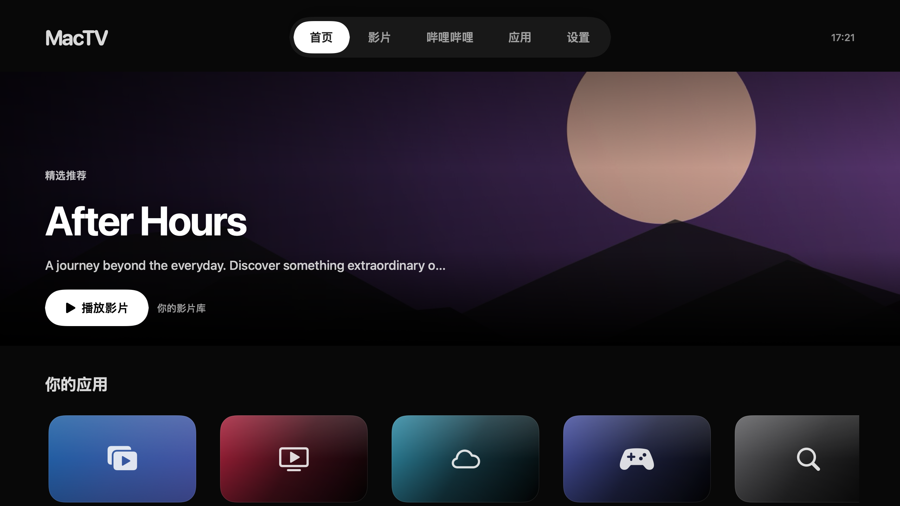

# MacTV

**让接上电视的 Mac，成为客厅的媒体中心。**

简体中文 · [English](docs/README.en.md)

用遥控器或触控板浏览海报墙，播放硬盘与网盘里的影片，打开哔哩哔哩，再通过相册、Steam 等应用扩展你的客厅。

[下载安装](https://github.com/Force1ess/MacTV/releases) · [开始使用](docs/GETTING-STARTED.zh-CN.md) · [反馈问题](https://github.com/Force1ess/MacTV/issues)

## 你的内容，一个大屏入口

- **影片海报墙**：添加硬盘或 SMB 共享，自动整理电影和剧集，更新海报，记录观看进度。
- **随心播放**：切换音轨和字幕、调整倍速、跳转进度，接着上次的位置继续看。
- **哔哩哔哩**：浏览首页、热门、排行榜、动态和收藏夹，选中视频直接播放，在播放栏选择画质。
- **夸克网盘**：扫码或从 Chrome 登录，浏览网盘目录，播放影片原片和内封字幕。
- **为沙发上的操作设计**：方向导航、逐层返回、屏幕键盘和中文拼音输入，搭配深色与浅色外观。
- **更多客厅应用**：用相册浏览本地和云端照片，一键进入 Steam 大屏模式，也可以添加其他插件来源。

## 开始使用

1. 下载 MacTV，将 **MacTV.app** 拖入“应用程序”。
2. 打开应用，按引导添加影片文件夹或 SMB 共享，选择电视或扬声器。
3. 登录哔哩哔哩、夸克，或直接播放自己的影片。推荐搭配方向键遥控器与触控板。

| 按键 | 操作 |
| --- | --- |
| ↑ ↓ ← → | 移动焦点；停留在顶栏时切换栏目 |
| Enter／确定 | 打开、播放或确认 |
| Esc／Backspace／返回 | 收起当前菜单，返回上一级 |
| 屏幕键盘 | 输入与删除文字 |

添加片库、Chrome 登录和遥控设置的详细步骤见[安装与使用](docs/GETTING-STARTED.zh-CN.md)。

## 扩展与参与

[MacTV-Plugins](https://github.com/Force1ess/MacTV-Plugins) 提供相册、Steam UI 和独立插件 SDK。

[插件开发](docs/PLUGIN-DEVELOPMENT.zh-CN.md) · [从源码构建](docs/BUILDING.zh-CN.md) · [参与贡献](docs/CONTRIBUTING.md) · [更新记录](docs/CHANGELOG.md)

MacTV 采用 [GPL-3.0](LICENSE)。[第三方说明](docs/THIRD-PARTY.zh-CN.md) · [隐私与权限](docs/PRIVACY.zh-CN.md) · [安全问题](docs/SECURITY.md)
