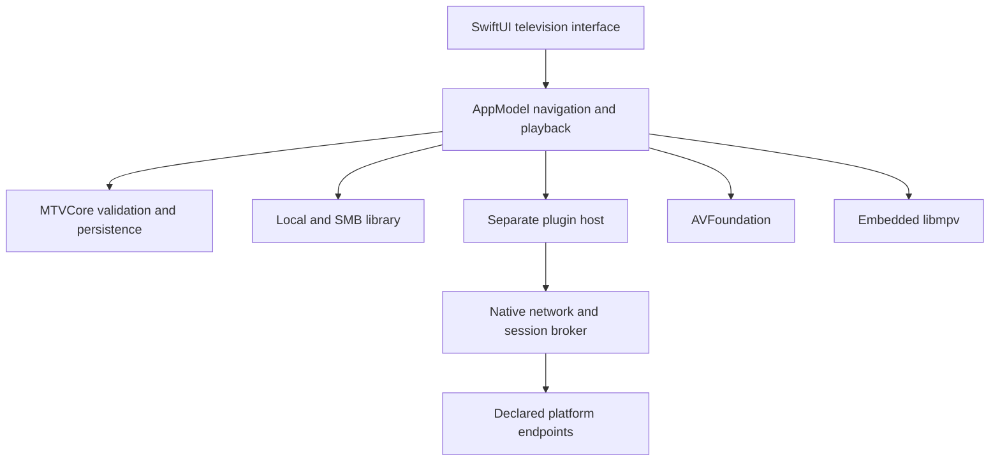

# Architecture

[简体中文](ARCHITECTURE.zh-CN.md)

MacTV is a standalone macOS application; no media server is required. The host
supports legacy API 1 and asynchronous API 2. Gallery and Steam UI are the first
independent example plugins; photo sources are host resources. See the
[pluggable architecture](PLUGGABLE-ARCHITECTURE.md) for its contracts and limits.

| Path | Responsibility |
| --- | --- |
| src/Sources/MTV | SwiftUI views, focus, input, playback state and installed-app tests. |
| src/Sources/MTVCore | Media identification, sources, metadata, session validation, storage and shared contracts. |
| src/Sources/MTVControl | The local `mtvctl` command-line client. |
| src/Sources/MTVChromeBridge | Separate versioned Chrome/key reader, without MTVCore or UI dependencies; parent validation, anonymous-pipe replies and cancellable reads. |
| src/Sources/MTVPluginHost | Separate JavaScript execution host. |
| src/Sources/MPVBridge | Dynamically loaded libmpv C interface and continuously consumed native event queue. |
| src/Sources/RimeBridge | Chinese on-screen keyboard interface. |
| src/integrations | Built-in Bilibili, Quark and Music adapters and manifests. |
| src/plugin-api | Legacy API 1 type declarations and example; API 2 SDK lives in MacTV-Plugins. |
| src/Tests/Fixtures/example-plugin | Host-test demo; never included in the app. |
| src/browser-extension | User-triggered Chrome-session import extension. |
| src/Tests/MTVCoreTests | Core behavior and permission-boundary tests. |
| config/playback-benchmarks.json | Playback measurement targets and budgets. |
| tools | Build, install, test and maintenance entry points. |

## Navigation and libraries

Native key events are checked against the active application/window and mapped
to shared actions by `TVKeyBindings`. Back dismisses the topmost notice, menu,
input or page. Views do not construct unrelated exit paths for every button.

Sources and indexes are isolated by source identity. Scans read filenames,
existing NFO files and neighboring artwork. Parsing versions and file state
control incremental updates. Metadata matches are saved in MacTV's cache,
without rewriting media. Automatic matches require a unique title match and,
where needed, matching year.

## Playback

Validated descriptions select AVFoundation or libmpv according to container and
capability. Users do not need to select an engine. Legacy VLC comparisons remain
in the source, but the default package excludes VLC.

Compatible Bilibili AVC/AAC tracks use a restricted local indexed HLS path. This
does not imply support for arbitrary DASH codecs. Quark originals use a native
range transport; cookies stay in the native session broker. libmpv observations
are cached asynchronously, with native frame estimates requested asynchronously
rather than synthesized. Decoding, frame display and physical TV HDR/audio
output are separate verification layers.

## Plugin boundary

Manifests declare capabilities, domains and native resources. JavaScript cannot
read arbitrary files, launch arbitrary processes or obtain raw cookies. Login
and authenticated network access remain in the native broker. The worker's
system sandbox does not replace plugin-source and dependency review.

## Programmatic control

When explicitly enabled, `AppControl` exposes the same `AppModel` through a
same-user Unix socket. `LocalControl` enforces bounded communication, peer
identity and expiry. The interface and SwiftUI use the same navigation, login
and playback logic. Protected text snapshots/events include separate scan IDs
and completion phases. This interface is not a content-plugin capability or a
credential-export channel. See [local control](LOCAL-CONTROL.md).

Independent plugins and the API 2 SDK live in [MacTV-Plugins/main](https://github.com/Force1ess/MacTV-Plugins/tree/main). Build tools clone that repository into an ignored cache; there is no source submodule. Release source archives record and include the exact plugin commit used.
