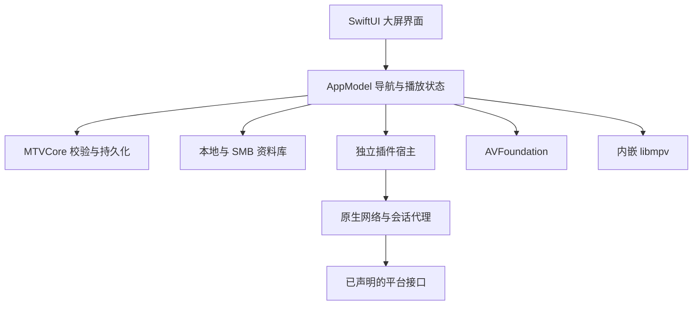

[English](ARCHITECTURE.md)

# 项目结构

本文描述当前 v1 实现。新的设计与迁移验收见
[Pluggable architecture v2](PLUGGABLE-ARCHITECTURE.md)（[中文](PLUGGABLE-ARCHITECTURE.zh-CN.md)）。
首批独立示例是相册和 Steam UI；图片源是资源连接。宿主支持异步 API 2，0.3 示例已迁移；旧 API 1 保持兼容。

MacTV 是独立运行的 macOS 应用，不要求先部署媒体服务器。

| 路径 | 职责 |
| --- | --- |
| src/Sources/MTV | SwiftUI 页面、焦点、输入、播放状态与界面专项测试 |
| src/Sources/MTVCore | 媒体识别、来源、元数据、会话校验、存储与共享协议 |
| src/Sources/MTVControl | mtvctl 本机控制命令行客户端 |
| src/Sources/MTVChromeBridge | 独立、版本化的Chrome原生连接与钥匙读取组件，无MTVCore/UI依赖；校验父进程、匿名管道返回、可终止读取 |
| src/Sources/MTVPluginHost | 独立 JavaScript 宿主 |
| src/Sources/MPVBridge | 动态载入 libmpv 的 C 接口 |
| src/Sources/RimeBridge | 中文屏幕键盘输入法接口 |
| src/integrations | 内置哔哩哔哩、夸克与音乐服务适配和声明。 |
| src/plugin-api | 插件类型声明与示例 |
| src/browser-extension | 用户主动触发的 Chrome 会话导入扩展 |
| src/Tests/MTVCoreTests | 核心逻辑与权限边界测试 |
| config/playback-benchmarks.json | 播放测量目标配置 |
| tools | 构建、安装、测试与维护入口 |

## 导航与资料库

原生键盘事件经过应用窗口和前台检查，由 TVKeyBindings 映射成统一动作。返回依次关闭最上层提示、菜单、输入或页面，不让每个按钮自行拼接退出路径。

来源与索引按来源隔离；扫描读取文件名、已有 NFO 与相邻图片。增量索引用解析版本和文件状态判断是否重新识别。元数据匹配写入 MacTV 缓存，不改写原媒体。自动匹配要求唯一结果，并核对片名和必要年份。

## 播放

解析产生经过域名和请求头校验的描述，按容器与能力选择 AVFoundation 或 libmpv。用户不需要选择引擎。旧 VLC 桥保留用于问题比较，默认包不携带 VLC。

Bilibili 的兼容 AVC/AAC 分轨通过受限的本机索引 HLS 路径播放，不代表任意 DASH 编码都兼容。解码、画面显示和电视 HDR/声音输出分别验证。

## 插件边界

模块声明能力和域名。JavaScript 不直接读取文件、运行子进程或获取原始 Cookie；登录和受保护联网操作留在原生代理。宿主的系统隔离不能代替模块来源和依赖审查。

## 可测试接口

AppControl 在明确开启时，通过同用户 Unix socket 调用同一个 AppModel。LocalControl负责有界通信、用户身份和请求过期校验；SwiftUI 与控制命令共用实际导航、登录和播放逻辑。状态和有限事件记录保存为受保护文本，扫描有独立任务身份与结果阶段。控制接口不属于内容插件能力，也不为脚本提供凭证通道，详见[本机接口](LOCAL-CONTROL.md)。

独立插件和 API 2 SDK 位于 [MacTV-Plugins/main](https://github.com/Force1ess/MacTV-Plugins/tree/main)。构建工具通过 Git 克隆到忽略目录，不使用子模块；发布源码包记录并包含当次使用的插件提交。
