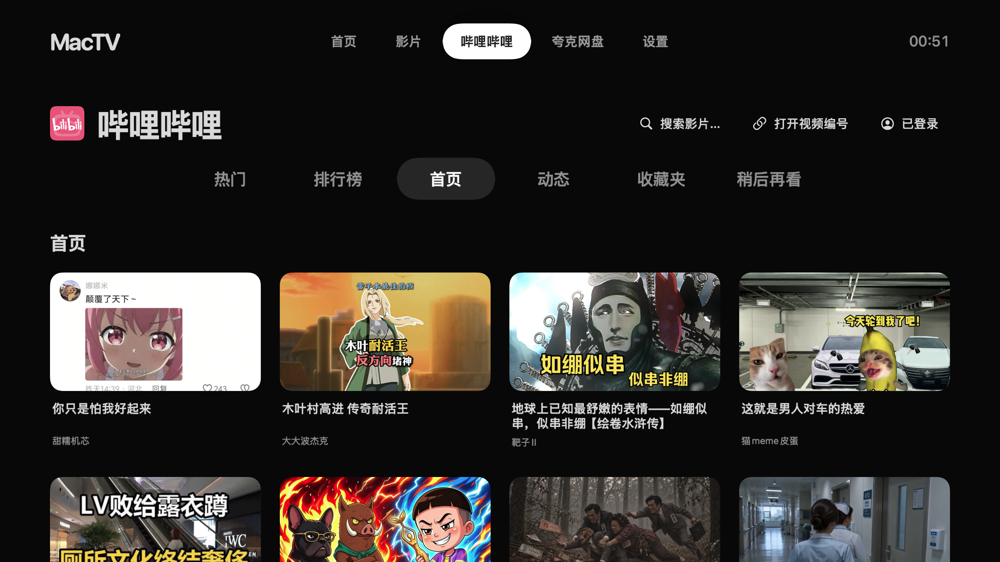
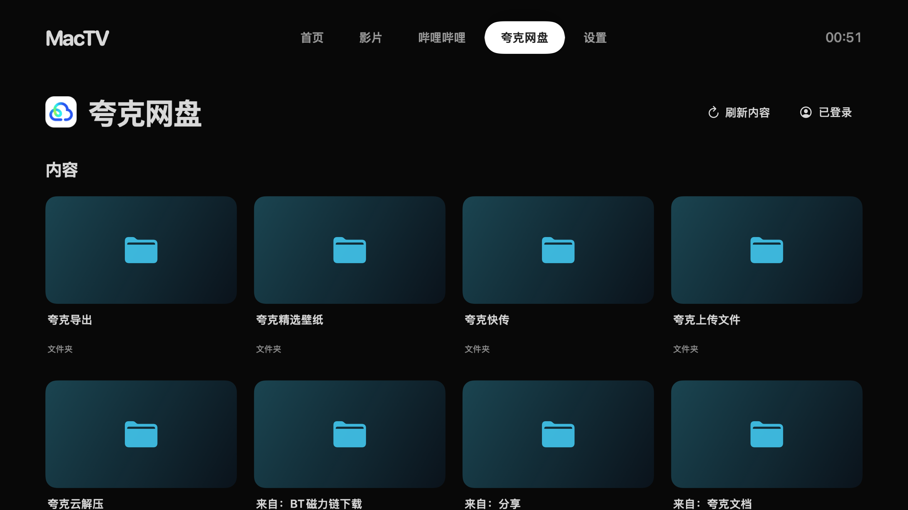

# MacTV

**A living-room media center for the Mac connected to your TV.**

[简体中文](../README.md) · English

Browse your poster wall with a remote or trackpad, play movies from disks and cloud storage, watch Bilibili, and bring photos and Steam to the same big-screen home.

<table>
  <tr><th>Poster wall</th><th>Bilibili</th></tr>
  <tr>
    <td width="50%"></td>
    <td width="50%"></td>
  </tr>
  <tr><th>Quark Drive</th><th>Playback</th></tr>
  <tr>
    <td width="50%"></td>
    <td width="50%"></td>
  </tr>
</table>

[Download](https://github.com/Force1ess/MacTV/releases) · [Get started](GETTING-STARTED.md) · [Report an issue](https://github.com/Force1ess/MacTV/issues)

## Your content, one big-screen home

- **A poster wall for your library**: add disks or SMB shares, organize movies and series, refresh artwork, and keep your watch progress.
- **Playback your way**: choose audio tracks and subtitles, change speed, seek, and resume where you left off.
- **Bilibili**: home, popular videos, rankings, activity, and favorites. Select a video to play, then choose quality from the playback controls.
- **Quark Drive**: sign in by QR code or Chrome, browse folders, open photos, and play original movies with embedded subtitles.
- **Designed for the couch**: directional navigation, consistent back controls, an on-screen keyboard with Chinese pinyin, and light/dark appearance.
- **More living-room apps**: open Steam Big Picture, or add another plugin source.

## Get started

1. Download MacTV and drag **MacTV.app** to Applications.
2. Follow setup to add a movie folder or SMB share and choose your TV or speakers.
3. Sign in to Bilibili or Quark, or start with your own movies. A directional remote and a trackpad are recommended.

## Extend and contribute

[MacTV-Plugins](https://github.com/Force1ess/MacTV-Plugins) provides Steam Big Picture and the independent plugin SDK.

[Build a plugin](PLUGIN-DEVELOPMENT.md) · [Build from source](BUILDING.md) · [Contribute](CONTRIBUTING.md) · [Changelog](CHANGELOG.md)

MacTV is licensed under [GPL-3.0](../LICENSE). [Third-party notices](THIRD-PARTY.md) · [Privacy](PRIVACY.md) · [Security](SECURITY.md)

## Contributors

<!-- contributors:start -->

<!-- contributors:end -->

## Star History

